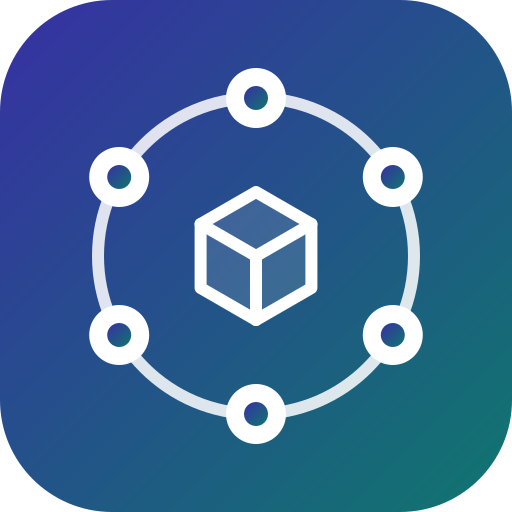

  

<h1 align="center">Friends Of Kubernetes</h1>

  Free, open-source tools for people who run their own Kubernetes clusters.

## Sextant

A desktop Kubernetes client, an alternative to Lens, written in Rust on [Tauri 2](https://tauri.app), with a
built-in MCP server for AI agents. Linux, macOS and Windows. No account, no server, no telemetry.

- **Every resource** in live tables with details, a YAML editor that knows the cluster's schema, logs, shells,
  port forwarding, Helm, Flux and Argo CD.
- **Problems and diagnosis**: a cluster's problems on one page with desktop notifications, why a Service gets no
  traffic, a live traffic graph, a change timeline, RBAC, network policy checks, right-sizing.
- **Safer changes**: a dry run and a diff before applying YAML or upgrading a Helm release, upgrade readiness and
  security posture.
- **The ecosystem**: Gateway API, Istio, Linkerd, Argo Rollouts and Workflows, cert-manager, Crossplane, Kyverno,
  OpenShift, k3s, vcluster and more, each read from the operator's own status.
- **AI agents**: connect Claude Code, Claude Desktop or Cursor through MCP, with permissions per cluster,
  confirmations in the window and an activity log.
- **In 14 languages.**

[Download](https://github.com/FriendsOfKubernetes/sextant/releases/latest) ·
[Install](https://github.com/FriendsOfKubernetes/sextant#install) (Homebrew, Scoop, `.deb`, `.rpm`, AppImage) ·
[Wiki](https://github.com/FriendsOfKubernetes/sextant/wiki) ·
[Why Sextant](https://github.com/FriendsOfKubernetes/sextant/wiki/Why-Sextant) ·
[Discussions](https://github.com/FriendsOfKubernetes/sextant/discussions)

### How it is made

Sextant's code is generated entirely by [Claude Code](https://claude.com/claude-code). A human sets the tasks,
makes the architecture decisions (recorded as [ADRs](https://github.com/FriendsOfKubernetes/sextant/tree/main/docs/adr))
and reviews every change; each change runs through more than 6,000 tests on Linux, macOS and Windows before it ships.

## Extensions

Sextant can be extended with your own pages, panels, actions and table columns. Extensions run in isolated frames,
optionally with a WebAssembly backend (TypeScript or Rust) that has no access to your files or network beyond the
hosts it declares, and every cluster call goes through the permissions you agree to.

- [**sextant-extensions**](https://github.com/FriendsOfKubernetes/sextant-extensions) is the extension catalog that
  Sextant shows under Settings → Extensions → Catalog. Each extension is one reviewed entry naming its GitHub
  repository and the publisher's [minisign](https://jedisct1.github.io/minisign/) key. Packages come from the
  publisher's releases and are verified by size, SHA-256 and signature before install; an update signed with another
  key is refused. To publish yours, see [CONTRIBUTING.md](https://github.com/FriendsOfKubernetes/sextant-extensions/blob/main/CONTRIBUTING.md).
- [**sextant-extension-examples**](https://github.com/FriendsOfKubernetes/sextant-extension-examples) holds the signed
  releases of the example extensions, which are the first entries of the catalog.
- To write an extension, start with [Writing extensions](https://github.com/FriendsOfKubernetes/sextant/wiki/Writing-extensions)
  and the SDK, template and examples in [`sdk/`](https://github.com/FriendsOfKubernetes/sextant/tree/main/sdk).

## Other repositories

- [homebrew-sextant](https://github.com/FriendsOfKubernetes/homebrew-sextant): the Homebrew tap,
  `brew install --cask friendsofkubernetes/sextant/sextant`
- [sextant-scoop](https://github.com/FriendsOfKubernetes/sextant-scoop): the Scoop bucket,
  `scoop bucket add sextant https://github.com/FriendsOfKubernetes/sextant-scoop`

## Support the project

Sextant is free and will stay free: every feature is for everyone, with no paid edition, account or telemetry.

If it saves you time and you want to say thanks, you can [buy the author a coffee](https://www.donationalerts.com/r/mxp100).
A ⭐ on [GitHub](https://github.com/FriendsOfKubernetes/sextant), a bug report, an idea in
[Discussions](https://github.com/FriendsOfKubernetes/sextant/discussions/categories/ideas), a correction to a
translation or a word about Sextant to your colleagues helps just as much.

## Contributing

Issues and pull requests are welcome in each project's repository. Everything here is dual-licensed under
MIT OR Apache-2.0 unless a repository says otherwise.
